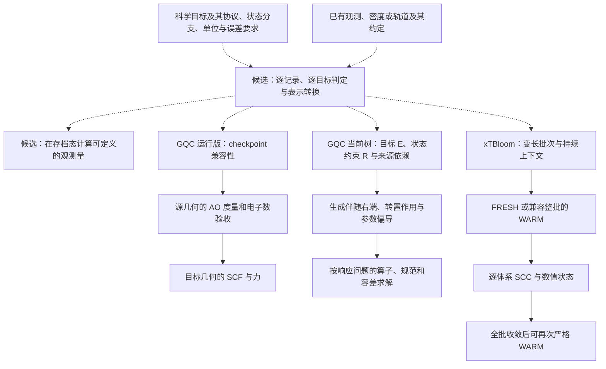

# 工作基础与剩余计算

下面的实线表示本轮追踪到的实现关系。两条 GQC 支路来自分别固定的版本。虚线表示要把真实数据档案接入现有路径仍需验证的项目工作。

| 层次 | 可继承的具体能力 | 项目要补的证据或改动 |
|---|---|---|
| 科学身份与表示 | GQC 的 resolved model、基组/表示、几何与控制比较，以及 xTBloom 有序 `SystemKey` | 外部记录须解析单位、AO 次序、实际参数、态与目标，只有通过验证的变换才能进入算符或求解路径 |
| 固定态与目标态 | CP-001 实跑验证了 GQC 的 seed 接纳、物理拒绝、原有状态保全和新目标求解 | 固定态后处理须给出算符、坐标系和原点。用热启动进入新目标后，评估该目标自己的收敛与分支 |
| 响应与误差 | 当前 GQC TensorIR 对已声明的驻点方程生成伴随片段；受支持的响应算子有占虚布局与真实残差检查；经验估计有校准域 | 用真实分子场扰动与独立参考验证存档值绑定后的响应；记录参考误差、状态稳定性与校准范围 |
| 执行与恢复 | xTBloom CPU 原生分子批次有逐项数值状态，持续工作区与整批 warm 条件可用于基线 | 跨批逐记录保留成功态会改变状态所有权和恢复语义，需比固定批、分上下文与完整重算，再决定是否改底层 |
| 数据集级计划 | 当前源码和实跑支撑以上单条路径；已有物性/状态的组合选择尚待跨记录验证 | 记录实际选择、拒绝、全部新增成本与下一轮命中，测量相对手写规则、普通缓存和联合计算的增量 |

图中的伴随求解器接口与方程编译器各自已有实现，图展示计算依赖；本轮 CPU 编译器测试由测试端提供伴随解。H₂ 能量与力、代数方程测试、xTBloom CPU 原生测试各有独立执行范围。未在该图中给出跨后端精度等价或免求解结论。[GQC 源码与数值证据](audits/gqc.md) · [xTBloom 源码与测试](audits/xtbloom.md) · [证据台账](claims.csv)
