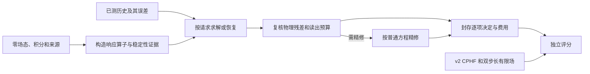

# 受控盲验后的取舍　保留质量入口，停止外推标量路线的生产净收益

2026-11-18，Codex。#14、#15 的阶段决定，承接 [v2 参照修订](0003-independent-response-qualification.md) 与 [单混合场策略](0003-partial-response-block.md)。输入为既有的 17 个 QM9 候选、事前固定的开发／留出分组、按来源绑定的状态及已测量历史。判据、执行上限与追加的稠密历史对照均先于各自的实测登记。[盲验协议](../experiments/target_quality/protocol.md) · [成本协议](../experiments/response_benefit/protocol.md) · [追加对照](../experiments/response_benefit/dense-history-protocol.md)

## 哪些决定可以在不知道真值时作出

仅给补全器源态、科学定义、实际请求，以及带有单位、生产证据和误差预算的历史。它复核响应方向的物理残差，按读出传递数值误差。已测量标量参与组合时按实际系数、绝对误差和浮点消减计算目标预算。先写出接受、精修、拒绝、证据不可得与已发生费用，再在另一进程读取 v2 表评分。

留出 11 个构型的 33 个请求中，8 份有态给出 24 个读出，3 份缺态的 9 项暂缓。完整历史和组合场的 24 项最大 CPHF 差为 9.73×10⁻¹²，计入独立参照的数值余量后，目标误差超过 1e−8 的接受项为零。量化历史须先精修其中 16 项。删去历史误差来源后，仅独立求得的 8 个 z 目标通过。两标量组合含建模、求解和复核花费 868 次 J/K，普通原生块 1,064 次，保留历史方向 564 次，已组装矩阵后直接稠密求解 64 次。四条路径都支付相同的 16 次 AO→MO 变换和 8 次 SVD；稠密路线还求解 24 个 RHS。本轮验证了稀疏读出的数值验收和失败处理。[生产入口、精修与成本](../experiments/target_quality/README.md)

数值估计针对存档的有限离散方程。在另一个严格对照中，把装配后的矩阵、右端和读出按二进制输入的精确实数解释，行对角占优与有理数残差给 3 份首批状态的一个读出取得严格界；其他 9 份有态（含全部 8 份留出）不满足充分条件。相同分子在不同实现构造的 SCF 态与算子之间仍有误差。pyMOR 的近奇异控制中，只传入一个刻意过大的稳定性因子，即可使误差为 0.25 的读出被错误接受。[确定性界的范围与成本](../experiments/represented_matrix_bound/README.md) · [已审计的估计器与反例](../audits/response-target-evidence.md)

## 资产和请求怎样改变成本

| 留出循环历史，后轮请求三个对角分量 | 后轮原生 J/K | 其他关键成本 |
|---|---:|---|
| 普通直接／伴随块 | 1,000／990 | 8 份有态分子的历史标量均有数值误差证据 |
| 自动双混合场／手写同式 | 824／824 | 单混合场规则在这个掩码为 1,000；自动方案与手写同成本 |
| 已存完整向量 | 24 | 逐方向原生复核，合计留存 61,419 字节；无损压缩为 36,926 字节 |
| 同一质量矩阵已付，再稠密求所需列 | 24 | 另计 24 列稠密 RHS，三次配对计时的后轮中位数为 52.9 ms |
| 首轮稠密预取全表 | 0 | 首轮 24 列稠密 RHS，留存含资格的表 33,028 字节 |

以上为 8 份有态分子的汇总，每个候选都在 11 分子的原分母内。使用留出循环历史时，普通生产后自动双场的后轮中位数为 1.421 秒，手写相同场方向为 1.434 秒；三个配对计时区间重叠。稠密丢弃方向、只保存已请求历史的首轮也已实测。按相同存储、求解及核验预算，两个低存储稠密方案在这个工作站与队列的条件比较中更便宜。若八个分子的总历史字节预算至少 33,028 且新增请求均为三目标，其条件期望时间在请求概率约 0.47 时由按需稠密求解转为首轮稠密预取。自然请求概率未知。[实测和参数区间](../experiments/response_benefit/README.md) · [含稠密历史生产的字节与概率条件](../experiments/response_benefit/dense-history/frontiers.csv)

试验保留了水上双场 3 RHS／22 J/K 到 2／20 的正例，也重现氨上 3／30 到 2／31 的反例。对 12 种策略、三个场景和重复测量共 4,032 个有态读出位置，独立门槛均通过。水的两个唯一读出在 124 个重复位置上的跨实现差异超过双方数值估计之和，仍在原定 1e−8 容差以内。数字按读出单位及唯一目标另有统计。线性可恢复性依靠逐行系数恒等式；RHS 数、真实算子工作与实测耗时另计。[物理对照、回执与误差](../experiments/response_benefit/evidence/summary.json)

## 继续与停止的条件

QM9 正式发布的 133,885 个成员、公共 QCArchive 的计算记录、Psi4/QCFractal 的实际样本，以及作者发布的水分布式偶极–四极响应格点均已核查。在这些材料中未取得与当前九个目标同协议、带足够精度的外部历史标量，也未取得后续消费者按分量的自然请求轨迹。公开水表和五位文本消费实测提供了基组、算符中心、迹与误差失配的具体依据。[资产与请求核查](../experiments/legacy_response_assets/README.md)

保留按目标的盲验、合法扣除和失败费用入口。停止以这组受控 QM9 请求支持标量方案有生产净收益的主张，也停止仅为放大当前 J/K 差额而扩充相同掩码的规模。重新考虑的条件是取得协议和误差可绑定的真实遗留标量及请求，或在缺少廉价稠密算子的其他物理范围找到更便宜且经独立留出检验的证据。届时普通、手写、向量、预取和最佳同质量求解都继续作为竞争方案。数据充分性、剩余程序、跨请求共享、质量证据和未来资产价值五条研究主线各有独立的后续问题。
